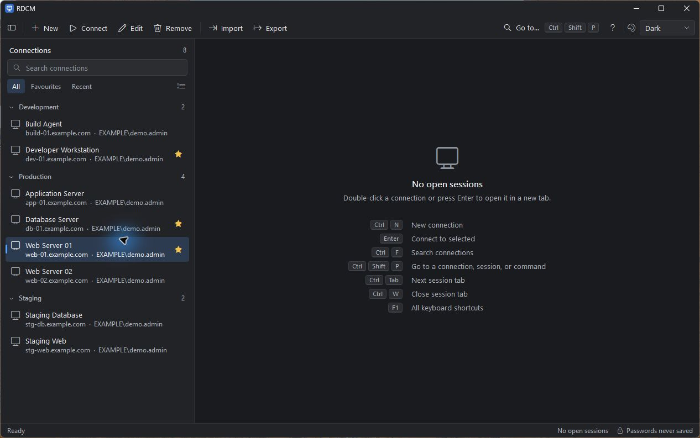
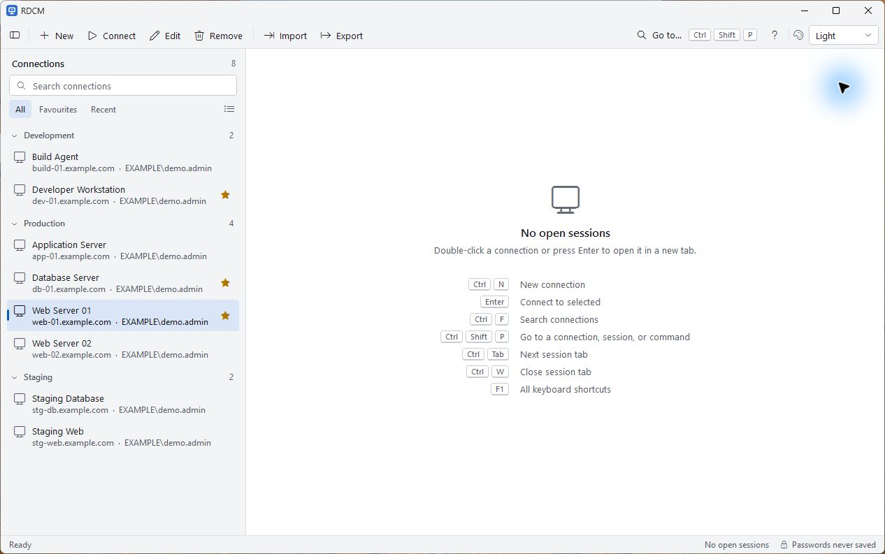
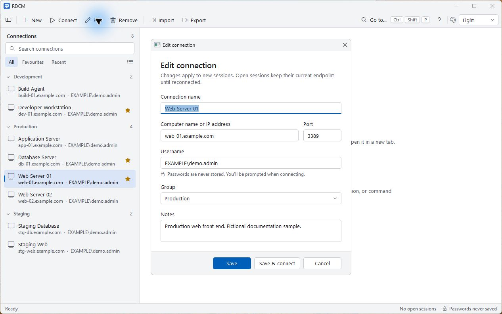
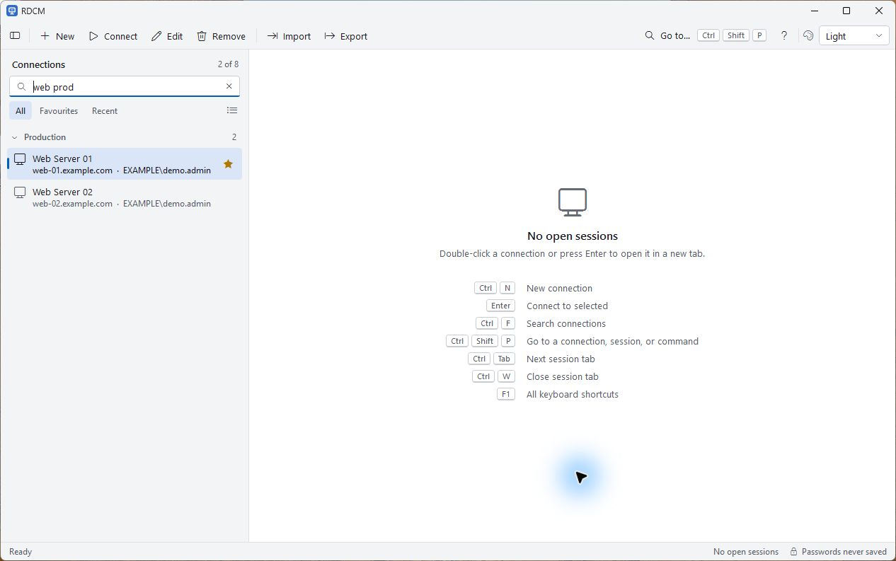
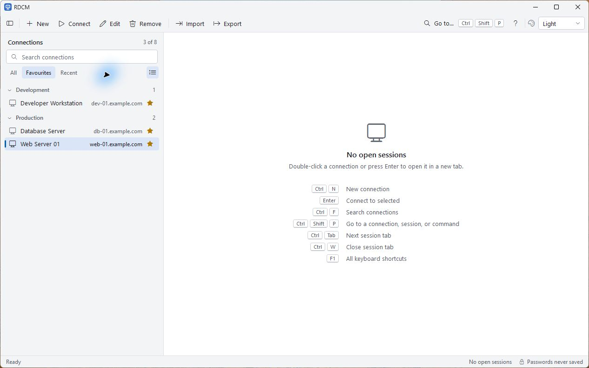
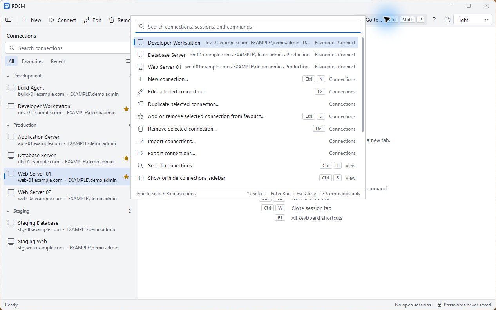

# RDCM screenshots

Screenshots of the installed RDCM build on Windows, using eight fictional connection profiles across Development, Production and Staging. All hostnames use `example.com`, and `EXAMPLE\demo.admin` is a sample username. No passwords or real server details are included.

## Dark appearance

Grouped profiles, favourite stars and the session workspace.

## Light appearance

The same connection workspace in light mode.

## Profile editor

Host, port, username, group and notes, with separate Save and Save & connect actions.

## Search

The query `web prod` finds the two production web servers.

## Compact favourites

Three starred connections in the compact, single-line list.

## Command palette

Favourite connections and application commands, available from Go to… or Ctrl+Shift+P.

## Demo profiles and capture notes

[demo-profiles.json](demo-profiles.json) can be loaded with **Import** to reproduce the connection list. Import adds profiles; use an empty demo workspace to avoid mixing them with your own. Mark Developer Workstation, Database Server and Web Server 01 as favourites to reproduce the starred entries.

Captured on 24 November 2026 at 1266 × 793 pixels. A temporary host loaded the installed `RDCM.dll` and its original resources, using the existing `MainWindow(ProfileStore, AppSettingsStore)` constructor with isolated demo files. The installed application binary and normal user profile store were not modified. The JPEGs are direct window captures; no remote sessions were connected for these screenshots.
